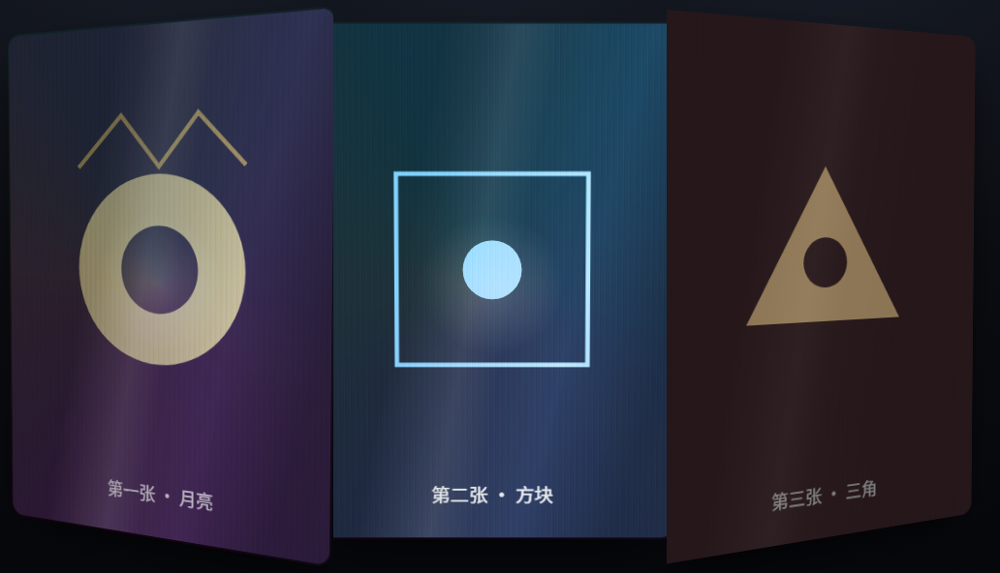
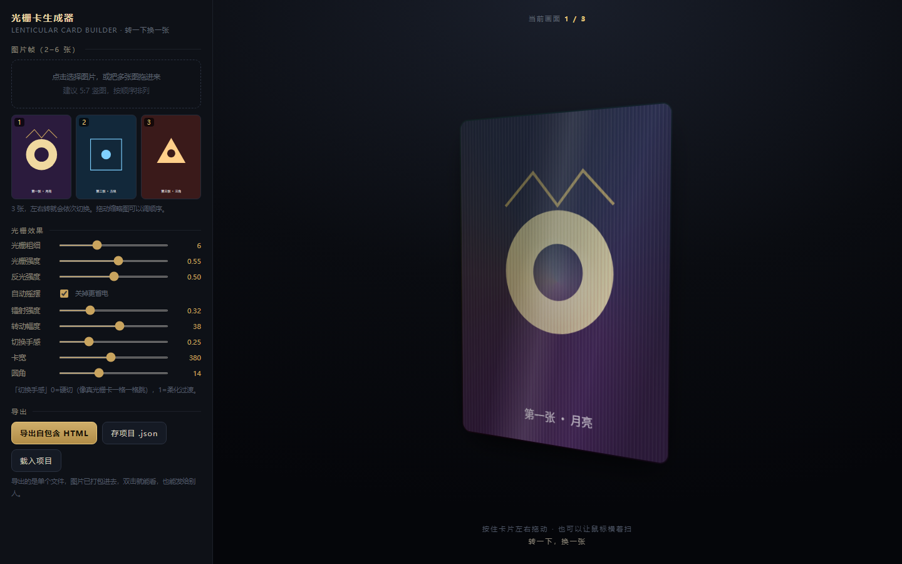

# Lenticular Holo Card · 光栅镭射卡生成器

**Tilt to flip.** 拖一下就换一张的 3D 光栅卡。

> 把 2–6 张图做成一张会「转一下换一张」的 3D 光栅卡：条纹、镭射、斜光照在鼠标那一侧跟着走。
> 纯前端单文件，零依赖、不联网，双击 `index.html` 就能用，导出的卡也是单个 HTML。



---

## 这是什么

小时候集卡，最神的是那种**光栅卡**：正着看是一个画面，歪一下换成另一个，还能看见细密的竖条纹和一层彩虹光。

这个工具用浏览器把那种感觉做出来了：

- 放进去 **2–6 张图**，按住卡片左右拖动，画面会随角度切换
- 四层效果叠在一起：**换图 + 光栅纹 + 镭射 + 斜光**
- 每一个效果都能单独调强度，调到你满意为止
- 点一下「导出自包含 HTML」，得到**一个文件**，图片已经打包进去，发给别人双击就能转



---

## 快速开始

1. 双击 `index.html`（Chrome / Edge / Safari 都行，不需要装任何东西）
2. 左侧虚线框里点一下，选 2–6 张图；也可以直接把图拖进去
3. 按住卡片左右拖 —— 看图是不是在换
4. 调滑杆调到你喜欢的样子，点「导出自包含 HTML」

第一次打开里面放了 3 张示例卡（内联 SVG 画的），可以先玩手感再换自己的图。docs/demo-export.html 就是导出后的样子，可以直接双击对比。

---

## 能调什么

| 滑杆 | 范围 | 作用 |
|---|---|---|
| 光栅粗细 | 2–14px | 条纹的疏密，越小越细腻 |
| 光栅强度 | 0–1 | 条纹的明暗对比，0 = 没有条纹 |
| 反光强度 | 0–1 | 卡面斜着划过的那道光 |
| 镭射强度 | 0–1.2 | 彩虹光膜，跟着鼠标走 |
| 转动幅度 | 10–60° | 转到多少度换一张，小 = 容易换 |
| 切换手感 | 0–1 | 0 = 硬切（像真卡一格一格跳），1 = 柔化叠化 |
| 卡宽 | 220–560px | 只是预览尺寸，导出时用同一个值 |
| 圆角 | 0–40px | 卡角半径 |
| 自动摇摆 | 开关 | 关掉后完全静止，省电、好截图 |

还可以：

- **拖动缩略图调整顺序**（决定左右转动的先后）
- **存项目 `.json` / 载入项目** —— 下次接着改，图片也一起存进去了
- **导出单个 HTML** —— 图片内联，无外部依赖，双击即看

---

## 怎么做的（技术说明）

没有 WebGL，没有 three.js，没有构建步骤，就一个 HTML 文件。

**1. 角度 → 画面**

卡片跟随指针做 `rotateY`（±转动幅度）。N 张图把整个角度区间均分，第 i 张的中心角是

```
c_i = -R + (i + 0.5) * (2R / N)
```

指针角度离谁近，谁就亮。权重是三角窗 `w = 1 - |ry - c_i| / span`，再用指数把边缘压硬：

```js
w = Math.pow(w, soft > 0.02 ? (4 - soft * 3) : 40)
```

`soft` 就是「切换手感」滑杆：指数越大，切换越硬。

**2. 光栅纹**

不是真网点，是一层 `repeating-linear-gradient` 的竖条纹，透明度由「光栅强度」控制。转动时条纹的 `background-position` 跟着角度轻微平移，看起来像镜片在动。

**3. 镭射**

`conic-gradient` + `radial-gradient` 两层合成，位置绑定鼠标坐标，`mix-blend-mode: screen` 叠在卡面上。

**4. 性能**

一开始拖动是卡的，原因很实在：手机拍的原图 3000px 以上，每帧都要重新缩放整张图，还叠着四层混合模式。改成了：

- 导入时用 canvas 压到**长边 1000px、webp 0.9**
- 条纹去掉 `mix-blend-mode`，改成直接透明度
- 鼠标移动**合并到一帧**（`requestAnimationFrame` 节流），不每个事件都重绘
- 卡片矩形**只在 pointerdown / resize 时算一次**，不在移动中读布局
- 帧层去掉 `transition`，加 `will-change` / `backface-visibility` 提示走合成层
- 「自动摇摆」可关闭，关掉后连动画循环都不跑

---

## 已知限制（说实话）

- 这是**屏幕上的模拟**：真光栅卡是物理网点交错 + 镜片膜，转动的角度和实际印刷不同。要拿去印刷，得另外做网点交错的底图（这个仓库还没做，欢迎 PR）。
- 导出的 HTML 里图片是 base64 内联，所以**文件会随图片数量变大**（每张压过 1000px 后大约几百 KB）。
- 图片不会被裁切，靠 `background-size: cover` 填满 5:7 的卡面，所以**素材比例最好就是 5:7**，不然会被切边。
- 卡顿如果还出现，优先把「自动摇摆」关掉试试；Safari 上 `mix-blend-mode` 的表现和 Chrome 略有差异。

---

## 素材建议

- 尺寸 **5:7 竖图**（例如 1000×1400），转起来最正
- 主体物留点边距，别贴边，转动时会被切
- 三张图之间**不要只是换颜色**，要有明显的构图差异，否则看不出来在换

---

## 发布到 GitHub

```bash
cd "E:\光栅镭射卡生成器"
git init
git add .
git commit -m "feat: 光栅镭射卡生成器 v1"
git branch -M main
git remote add origin https://github.com/<你的用户名>/lenticular-holo-card.git
git push -u origin main
```

想让人**在线直接玩**：仓库 Settings → Pages → Source 选 `main` / `root`，过一会儿访问
`https://<你的用户名>.github.io/lenticular-holo-card/` 就是可用的页面（`index.html` 已经在根目录）。

建议填的仓库信息：

- 描述：`纯前端单文件｜把 2–6 张图做成会「转一下换一张」的 3D 光栅卡，带条纹、镭射和跟随鼠标的斜光，可导出单文件 HTML`
- Topics：`css3d` `lenticular` `holographic` `card` `no-dependencies` `single-file` `vanilla-js`

---

## English

A single-file, dependency-free web tool that turns 2–6 images into a lenticular/holographic 3D card:
tilt it to switch frames, with ribs, rainbow foil and a specular sweep that follows your cursor.
Drop images in, tweak the sliders, export one self-contained HTML file.

Open `index.html`. No build, no CDN, works offline.

---

## License

MIT —— 见 [LICENSE](LICENSE)。用别人的图做卡请注意素材版权。
