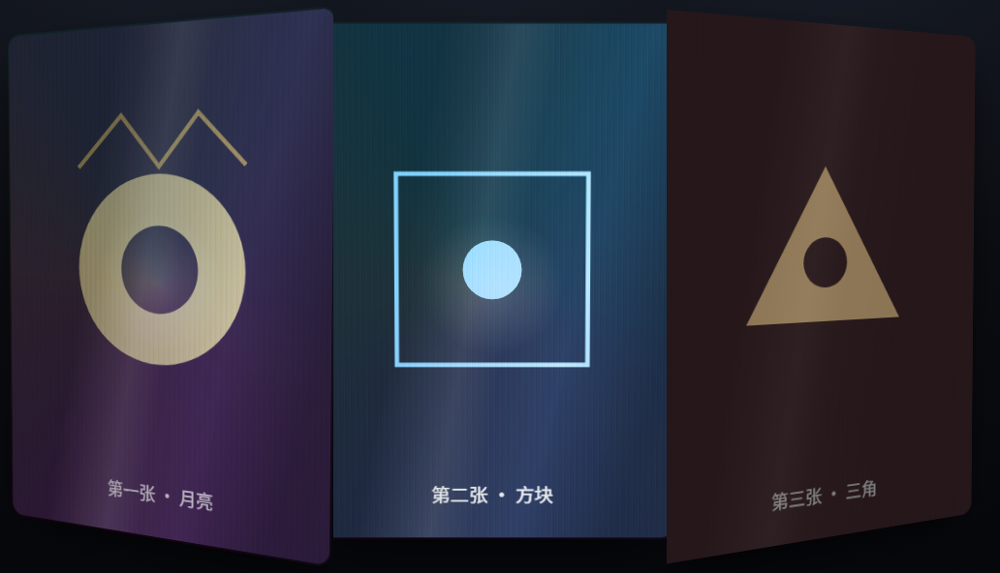
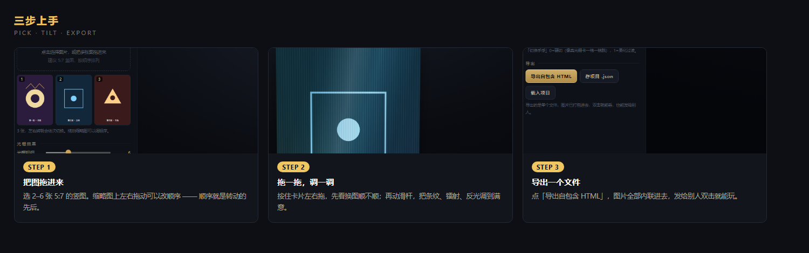
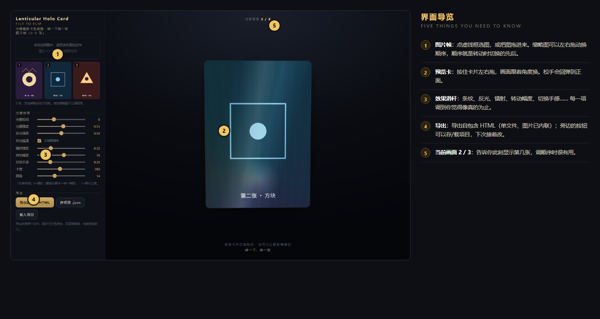

# Lenticular Holo Card · 光栅镭射卡生成器

**Tilt to flip.** 拖一下就换一张的 3D 光栅卡。

把 2–6 张图做成一张会随角度切换的卡片：细密的竖条纹、跟手走动的彩虹镭射、划过卡面的斜光，全部在浏览器里实时渲染。
纯前端单文件，零依赖、不联网、不需要构建 —— 双击 `index.html` 就能用，导出的成品也是单个 HTML。



> 左边是界面，右边是五个要点 —— 没耐心读文档的话，看这张图就能上手。

---

## 目录

- [这是什么](#这是什么)
- [为什么做它](#为什么做它)
- [快速开始](#快速开始)
- [界面说明](#界面说明)
- [能调什么](#能调什么)
- [技术原理](#技术原理)
- [性能优化](#性能优化)
- [已知限制](#已知限制)
- [素材建议](#素材建议)
- [常见问题](#常见问题)
- [路线图](#路线图)
- [许可证](#许可证)

---

## 这是什么

小时候集卡，最神的是那种**光栅卡**：正着看是一个人，歪一下变成另一个人，凑近还能看见一行行细密的竖纹，稍微晃一下就有彩虹光扫过去。

真卡靠的是透镜片（lenticular lens）和网点交错印刷。这个工具用浏览器把那种「看的角度不同、画面就不同」的体验做了出来：

- 放进 **2–6 张图**，按住卡片左右拖，画面跟着角度换
- 四层效果叠加：**换图 + 光栅纹 + 镭射 + 斜光**
- 每层强度都能单独调，调到你觉得像真的为止
- 点「导出自包含 HTML」，拿到**一个文件**，图片已内联，发给别人双击就能转

它不是渲染农场，也不是设计软件 —— 它是一个**小而完整的玩具**：打开即用，改参数即时看到反馈，导出就是一个能发出去的作品。

## 为什么做它

市面上做光栅/镭射卡的工具，基本两条路：要么是专业 3D 软件（Blender + 材质 + 渲染，学习曲线陡），要么是在线服务（上传、付钱、下载图片，改不了细节）。

这个项目的取舍很明确：**去掉一切部署成本，只保留「转一下换一张」这件事本身的乐趣**。

- 不需要装任何东西：一个 HTML 文件
- 不需要服务器：所有计算在本地
- 不需要联网：断网也能跑
- 不需要导出图片再拼：所见即所得，导出就是成品

## 快速开始

1. 双击 `index.html`（Chrome / Edge / Safari 都可以）
2. 左侧虚线框点一下，选 2–6 张图；也可以直接把图拖进去
3. 按住卡片左右拖动，看图是不是在换
4. 拖滑杆调到满意，点 **导出自包含 HTML**

第一次打开自带 3 张示例卡（内联 SVG 画的月亮 / 方块 / 三角），可以先玩手感，再换成自己的图。`docs/demo-export.html` 是导出后的样子，可以双击对比。



## 界面说明



| 区域 | 作用 |
|---|---|
| 左上「图片帧」 | 缩略图列表，**拖动可以调顺序**，决定左右转动的先后；每张右下角可删 |
| 中间预览 | 卡片本体，按住左右拖动；松开后会回弹到正面 |
| 顶部「当前画面 2 / 3」 | 告诉你此刻显示的是第几张 |
| 左下滑杆 | 所有效果参数，见下一节 |
| 左下按钮 | 导出自包含 HTML / 存项目 JSON / 载入项目 |

## 能调什么

| 滑杆 | 范围 | 作用 | 调它的时机 |
|---|---|---|---|
| 光栅粗细 | 2–14px | 条纹疏密，越小越细腻 | 想更像真卡就调小；想强调条纹感就调大 |
| 光栅强度 | 0–1 | 条纹明暗对比，0 = 完全没有 | 图本身很花时调低，避免脏 |
| 反光强度 | 0–1 | 卡面斜着划过的那道光 | 想要塑料膜质感就拉高 |
| 镭射强度 | 0–1.2 | 彩虹光膜，跟随鼠标 | 默认 0.32；太高会洗掉画面颜色 |
| 转动幅度 | 10–60° | 转到多少度换一张 | 小 = 容易换，适合手持感；大 = 更有 3D 纵深 |
| 切换手感 | 0–1 | 0 = 硬切（一格一格跳），1 = 柔化叠化 | 想仿真卡用 0；想要丝滑过渡用 0.3 以上 |
| 卡宽 | 220–560px | 预览尺寸，导出沿用同一个值 | 放进网页时按容器宽度定 |
| 圆角 | 0–40px | 卡角半径 | 真卡是圆角，8–16 最像 |
| 自动摇摆 | 开关 | 关掉后完全静止 | 省电、好截图、拖动更跟手 |

另外两个实用功能：

- **存 / 载项目 JSON**：图片和参数一起存进文件，下次接着改，不用重新导入
- **导出自包含 HTML**：图片内联成 data URI，单文件分发，无外部依赖

## 技术原理

没有 WebGL，没有 three.js，没有构建步骤。一个 HTML 文件，原生 CSS 3D + JS。

### 1. 角度 → 画面

卡片跟随指针做 `rotateY`（限制在 ±转动幅度内）。N 张图把整个角度区间均分，第 i 张的中心角是：

```
c_i = -R + (i + 0.5) * (2R / N)
```

指针角度离哪个中心角近，哪张图就亮。权重用三角窗：

```
w = 1 - |ry - c_i| / span
```

再用指数把边缘压硬，指数由「切换手感」控制：

```js
w = Math.pow(w, soft > 0.02 ? (4 - soft * 3) : 40)
```

`soft = 0` 时指数取 40，结果是几乎只有离得最近的那张可见 —— 就是真卡那种「一格一格跳」的硬切。

### 2. 光栅纹

不是真网点，是一层 `repeating-linear-gradient` 竖条纹，透明度由「光栅强度」控制。转动时条纹的 `background-position-x` 跟着角度平移，看起来像镜片在动。

### 3. 镭射

`conic-gradient`（彩虹环）+ `radial-gradient`（跟随鼠标的光斑）两层合成，`mix-blend-mode: screen` 叠在卡面上。反光层是一道斜向 `linear-gradient`，位置同样跟着指针。

### 4. 交互

- `pointerdown/move/up` 统一处理，鼠标和触屏同一套代码
- 拖动结束用缓动回弹到正面
- 自动摇摆模式让卡片缓慢来回晃，同时高光游走

## 性能优化

第一版拖动是卡的。原因很实在，五个都在：手机拍的原图动辄 3000px 以上，每帧都要重新缩放整张图；四层 `mix-blend-mode` 叠在 3D 变换元素上，浏览器只能慢慢合成；每次 `pointermove` 都调 `getBoundingClientRect` 强制布局；每个事件都触发重绘；帧层还带着 `transition`。

改法：

1. **导入时压图**：canvas 缩到长边 1000px、webp 质量 0.9，原图已经够小就跳过
2. **减少混合层**：条纹层去掉 `mix-blend-mode`，改用直接透明度叠加
3. **合并重绘**：`pointermove` 只记录坐标并调 `requestAnimationFrame`，一帧最多画一次
4. **缓存布局**：卡片矩形在 `pointerdown` / `pointerenter` / `resize` 时算一次，移动中不再读 DOM
5. **交给合成器**：帧层去掉 `transition`，加 `will-change: opacity` 和 `backface-visibility: hidden`
6. **可关闭动画**：自动摇摆关掉后，连动画循环都不再跑

结论：现在普通办公本拖起来也是跟手的；如果你还在卡，先关自动摇摆试试。

## 已知限制

说实话，这些是真的：

- **这是屏幕模拟**，不是物理仿真。真卡的角度响应、条纹摩尔纹、印刷网点都不一样。要拿去印刷，需要另外生成交错的网点底图，这个仓库还没做。
- **导出文件会变大**：图片是 base64 内联，每张压过之后大约几百 KB，6 张图可能到几 MB。
- **不裁切图片**：靠 `background-size: cover` 填满 5:7 卡面，比例不对会被切边。
- **Safari 的混合模式表现**和 Chrome 有细微差异，极端参数下颜色可能不同。
- **不支持视频/GIF** 作为帧，只用静态图。

## 素材建议

- **尺寸 5:7 竖图**（比如 1000×1400），转起来最正
- **主体物留边距**，别贴边，转动时边缘会被切掉
- 几张图之间**要有明显构图差异**，只换颜色的话看不出来在换
- 三张以内最稳，六张以上切换会变得很碎

## 常见问题

**Q：为什么导出的 HTML 打开是空白？**
A：浏览器安全策略对 `file://` 下的某些操作有限制。换成 Chrome/Edge 打开；如果用了内联 SVG 示例帧，确认文件完整（大小应该有几 MB，不是 0）。

**Q：能做成 GIF 或视频吗？**
A：不能直接导出。但你可以录屏：把自动摇摆打开，用系统录屏录一段，再用 ffmpeg 转成 GIF。

**Q：能放到自己的网站上吗？**
A：可以。导出的 HTML 是自包含的，直接放进 `iframe` 或者内联到页面都行。想嵌多个卡就导出多份，参数各自独立。

**Q：图片顺序怎么改？**
A：在缩略图上拖动，左右交换。

## 路线图

- [ ] 网点交错底图导出（印刷用）
- [ ] 支持 GIF / 视频帧
- [ ] 导出时可选压缩质量
- [ ] 深色/浅色主题切换
- [ ] 多卡批量导出

## 许可证

MIT —— 见 [LICENSE](LICENSE)。用别人的图做卡请注意素材版权。
